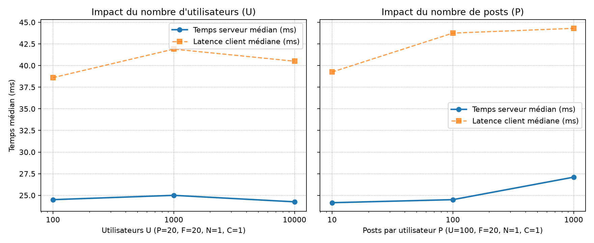
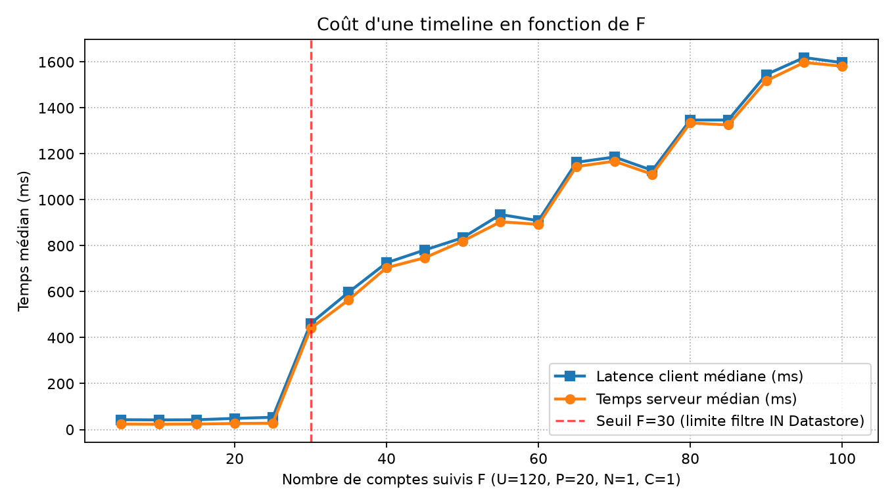
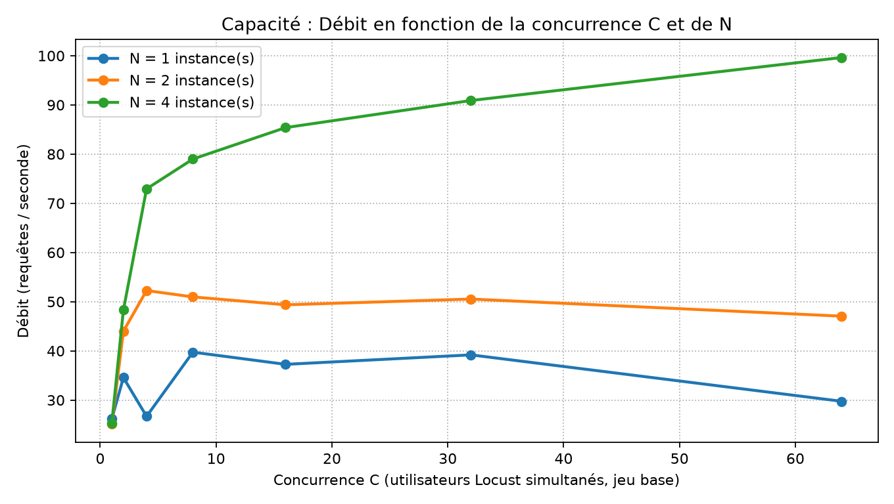
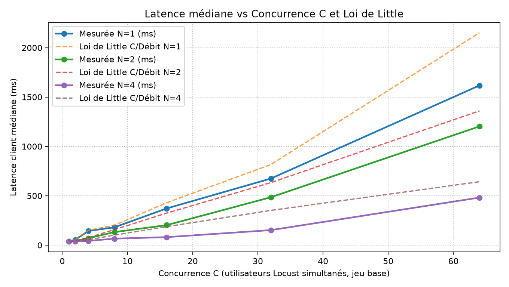
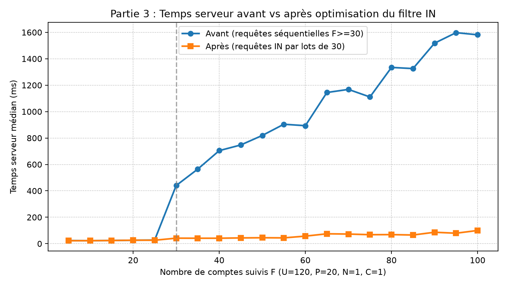

# TinyInsta passe-t-elle à l’échelle ? — Rapport expérimental

## 1. Montage

* **Projet GCP** : `projetmassivedata-511513`
* **Région** : `europe-west1` (`ew.r.appspot.com`)
* **Stockage** : Google Cloud Datastore (Firestore en mode Datastore), entités `User` et `Post`, index composite `Post(author ASC, created DESC)` (`index.yaml`).
* **Versions déployées (Google App Engine)** :
  * `default` (`20261013t145439`) : autoscaling (`F1`, `max_instances: 10`), `gunicorn -b :$PORT main:app`.
  * `fixed1`, `fixed2`, `fixed4` : scaling manuel (`B1`, 128 Mo RAM, 600 MHz, respectivement $N = 1, 2, 4$ instances fixes) pour les Parties 1 et 2.
  * `fixed1-opt` : version isolée (`--no-promote`, 1 instance `B1`) intégrant le découpage par lots de 30 auteurs dans `get_timeline` pour la Partie 3.
* **Dates et environnement de mesure** : mesures exécutées du 24 au 27 novembre 2026 avec Locust (`bench/locustfile.py`, boucle fermée `wait_time = constant(0)`, un utilisateur TinyInsta distinct par utilisateur Locust) depuis **Google Cloud Shell** (`Python 3.12`, Linux).
* **Reproductibilité** : toutes les figures (`figures/fig1a.png` à `fig3.png`) et données agrégées (`figures/fig1a.csv` à `fig3.csv`) sont régénérées en une commande depuis les journaux bruts (`raw/`) via `python3 bench/make_figures.py`.

---

## 2. Résultats

### Partie 1 : Coût d'une requête

#### Hypothèse
Dans `main.py`, `get_timeline(user, limit=20)` réalise :
1. Une lecture directe par clé primaire `client.get(client.key('User', user))` pour récupérer la liste `follows` ($O(1)$).
2. Une requête sur `Post` filtrée par `author IN follows` et triée via l'index composite `(author ASC, created DESC)` avec `limit=20`.

On formule donc les hypothèses suivantes (sur `fixed1`, $N=1$, concurrence $C=1$) :
* **Facteur $U$** : temps serveur constant ($O(1)$), car l'accès passe par clé primaire et index sans balayage complet (*Seq Scan*).
* **Facteur $P$** : temps serveur quasi constant, l'index trié décroissant sur `created` permettant de s'arrêter dès les 20 premiers résultats.
* **Facteur $F$** : temps constant tant que $F + 1 \le 30$ (plafond du filtre `IN` de Datastore), puis dégradation linéaire pour $F \ge 30$ lorsque `main.py` bascule dans le bloc `except` et exécute $F + 1$ requêtes séquentielles.

#### Figures
* **Figure 1a** : Temps serveur médian et latence client médiane selon $U$ et $P$ (`figures/fig1a.csv`)
  
* **Figure 1b** : Temps serveur médian et latence client médiane selon $F$ (`figures/fig1b.csv`)
  

#### Interprétation et réponses aux questions
* **Validation des hypothèses** :
  * **Facteur $U$ ($P=20, F=20$)** : confirmé. Le temps serveur médian reste constant à **$24,5\text{ ms}$** ($U=100$), **$25,0\text{ ms}$** ($U=1\,000$) et **$24,25\text{ ms}$** ($U=10\,000$).
  * **Facteur $P$ ($U=100, F=20$)** : confirmé. Le temps serveur médian varie très peu : **$24,15\text{ ms}$** ($P=10$), **$24,5\text{ ms}$** ($P=100$) et **$27,1\text{ ms}$** ($P=1\,000$).
  * **Facteur $F$ ($U=120, P=20$)** : confirmé avec une rupture brutale à **$F = 30$**. De $F = 5$ à $F = 25$, le temps serveur reste entre **$23,0\text{ ms}$** et **$27,4\text{ ms}$**. Dès $F = 30$ ($31$ auteurs avec l'utilisateur lui-même), il bondit à **$440,2\text{ ms}$** ($\times 16$) et atteint **$1\,581,5\text{ ms}$** à $F = 100$ (débit chutant de $21,3\text{ req/s}$ à $0,58\text{ req/s}$).
* **Part du réseau dans la latence client** : la latence réseau (`client_med_ms - server_med_ms`) est stable autour de **$14\text{ à }33\text{ ms}$**. Pour $F \le 25$, le réseau représente **$35\,\% \text{ à } 48\,\%$** de la latence client totale ($\approx 40 - 53\text{ ms}$) ; pour $F \ge 30$, le serveur domine largement et le réseau ne représente plus que **$1\,\% \text{ à } 5\,\%$** du temps total.
* **Entités Datastore lues et coût pour 1 million de timelines** (tarif Datastore : $0,06\text{ \$} / 100\,000$ lectures, soit $0,60\text{ \$} / 1\text{ M}$ entités lues) :
  * **Variation de $U$ ou $P$ (avec $F = 20$)** : $1\text{ User} + 20\text{ Posts} = \mathbf{21\text{ entités lues}}$ par timeline $\rightarrow$ $21\text{ M}$ lectures pour $1\text{ M}$ timelines, soit **$\approx 12,60\text{ \$}$**.
  * **Variation de $F$ ($F \le 29$)** : toujours **$\mathbf{21\text{ entités lues}}$** ($\approx 12,60\text{ \$}$ pour $1\text{ M}$ timelines).
  * **Variation de $F$ ($F \ge 30$, code initial)** : $1\text{ User} + 20 \times (F + 1)\text{ Posts}$ lus. À $F = 30$ : **$621\text{ entités}$** ($\approx 372,60\text{ \$} / 1\text{ M}$ timelines). À $F = 100$ : **$2\,021\text{ entités}$** ($\approx 1\,212,60\text{ \$} / 1\text{ M}$ timelines).

---

### Partie 2 : Capacité

#### Hypothèse
Chaque instance `B1` démarre avec `gunicorn -b :$PORT main:app`, soit **1 seul processus worker synchrone** qui traite une requête à la fois et reste bloqué pendant les entrées/sorties réseau vers Datastore ($\approx 25\text{ ms}$ par requête sur `base`).
* **Capacité et saturation** : une instance doit saturer dès $C \approx 1\text{ à }2$ requêtes simultanées autour de $\sim 35 - 40\text{ req/s}$. Au-delà, le débit plafonne et les requêtes s'empilent en file d'attente : la latence croît linéairement selon la **loi de Little** ($\text{Latence} \approx C / \text{Débit}$).
* **Passage à l'échelle sur $N \in \{1, 2, 4\}$** : les instances étant sans état (*stateless*) et les lectures Datastore réparties sur $1\,000$ utilisateurs distincts sans contention d'écriture, multiplier $N$ par $k$ doit multiplier le débit maximal par environ $k$, sous réserve que le client Locust (Cloud Shell) ne devienne pas un goulot.

#### Figures
* **Figure 2a** : Débit (req/s) en fonction de la concurrence $C$ et du nombre d'instances $N$ (`figures/fig2a.csv`)
  
* **Figure 2b** : Latence médiane mesurée vs prédiction de la loi de Little (`figures/fig2b.csv`)
  

#### Interprétation et réponses aux questions
* **Point de saturation et capacité d'une instance** :
  * Pour **$N = 1$**, le débit atteint son plateau dès **$C = 2$** ($34,57\text{ req/s}$) et culmine à **$39,74\text{ req/s}$** ($C = 8$), puis stagne autour de $37 - 39\text{ req/s}$ jusqu'à $C = 32$ avant de fléchir à $29,75\text{ req/s}$ à $C = 64$. Cette limite vient du **worker Gunicorn unique et synchrone** de chaque instance `B1`.
  * Pour **$N = 2$**, le débit sature à **$C = 4$** avec un pic à **$52,27\text{ req/s}$** (puis plateau autour de $49 - 51\text{ req/s}$).
  * Pour **$N = 4$**, le débit monte progressivement jusqu'à **$99,63\text{ req/s}$** à **$C = 64$** ($72,94\text{ req/s}$ à $C = 4$, $85,39\text{ req/s}$ à $C = 16$).
* **Vérification de la loi de Little** : au-delà du point de saturation, la latence croît proportionnellement à $C$ (ex. pour $N=1$, la médiane passe de $54,4\text{ ms}$ à $C=2$ à $180,6\text{ ms}$ à $C=8$, $674,7\text{ ms}$ à $C=32$ et $1\,617,7\text{ ms}$ à $C=64$). La prédiction théorique $C / \text{Débit}$ ($201,3\text{ ms}$, $816,6\text{ ms}$, $2\,151,3\text{ ms}$) suit la même pente mais reste légèrement au-dessus de la médiane car la loi de Little porte sur la latence **moyenne** (tirée vers le haut par la queue de distribution à $5 - 15\text{ s}$).
* **Passer de 1 à 4 instances multiplie-t-il le débit maximal par 4 ?**
  * **Non** : le débit maximal passe de **$39,74\text{ req/s}$** ($N=1$) à **$99,63\text{ req/s}$** ($N=4$), soit un facteur **$\times 2,51$** au lieu de $\times 4$.
  * **Identification du goulot** : le temps serveur médian reste parfaitement stable à **$25,3 - 26,3\text{ ms}$** sur $N=4$ même à $C=64$, ce qui prouve que ni les instances App Engine ni Datastore ne sont saturés. Le plafond à $\sim 100\text{ req/s}$ provient du **client de charge Locust exécuté sur la VM Cloud Shell** (mono-processus Python gérant 64 connexions HTTPS concurrentes et la résolution DNS, comme le confirment les quelques erreurs `gaierror` observées au démarrage des runs à forte concurrence).

---

### Partie 3 : Corriger et re-mesurer

#### Hypothèse et correction apportée
Pour éliminer l'effondrement observé à $F \ge 30$ sans alourdir les écritures ni introduire de cohérence à terme (contrairement à une matérialisation *fan-out* à l'écriture), `get_timeline` dans `main.py` est modifiée pour découper `follows` en **sous-listes de 30 auteurs maximum** et exécuter $\lceil (F + 1) / 30 \rceil$ requêtes `IN` indexées.
On attend un temps serveur quasi constant (inférieur à $100\text{ ms}$) jusqu'à $F = 100$.

#### Figure
* **Figure 3** : Temps serveur médian avant et après découpage par lots de 30 (`figures/fig3.csv`)
  

#### Interprétation et compromis
* **Gain mesuré** : pour $F \le 25$, les performances sont inchangées ($\sim 22,2 - 26,4\text{ ms}$, un seul lot de $\le 30$). Dès **$F = 30$**, le temps serveur médian passe de **$440,2\text{ ms}$ à $41,7\text{ ms}$** (**$-90,5\,\%$**). À **$F = 100$**, il passe de **$1\,581,5\text{ ms}$ à $99,9\text{ ms}$** (**$-93,7\,\%$**, soit un gain compris entre **$-90,5\,\%$ et $-95,1\,\%$** sur toute la plage $F \in [30, 100]$).
* **Coût de la correction** :
  * *Complexité* : très faible (quelques lignes Python pour partitionner la liste et fusionner les résultats en mémoire, sans changer le schéma Datastore ni les index).
  * *Coût financier* : division par **25** du nombre d'entités lues à $F = 100$ (au plus $1 + 4 \times 20 = \mathbf{81\text{ entités}}$ via 4 requêtes `IN` contre $2\,021\text{ entités}$ auparavant), ramenant le coût de $1\text{ M}$ timelines de $1\,212,60\text{ \$}$ à **$\le 48,60\text{ \$}$**.
  * *Cohérence des données* : strictement préservée (lecture à la volée sans duplication des posts).

---

## 3. Tableau des verdicts

| Dimension | Passe à l’échelle ? | Jusqu’où ? | Pourquoi (mécanisme) | Preuve |
|---|---|---|---|---|
| **Utilisateurs (U)** | **Oui** | Testé jusqu'à $U = 10\,000$ (extensible tant que l'index tient) | Lecture par clé primaire `User` et requête indexée sur `Post(author, created DESC)` sans balayage global ($O(1)$, $\sim 24,5\text{ ms}$). | Fig. 1a |
| **Posts par utilisateur (P)** | **Oui** | Testé jusqu'à $P = 1\,000$ ($100\,000$ posts au total) | L'index composite trié décroissant sur `created` + `limit=20` évite de lire les posts anciens ($\sim 24,2 - 27,1\text{ ms}$). | Fig. 1a |
| **Followees (F)** | **Non** (avant) / **Oui** (après) | Bloqué à **$F = 29$** avant ; fluide jusqu'à **$F = 100$** après | Plafond de 30 valeurs du filtre `IN` Datastore déclenchant $F+1$ requêtes séquentielles avant correction ; levé par découpage en lots de 30. | Fig. 1b, Fig. 3 |
| **Instances (N)** | **Partiellement** ($\times 2,51$ pour $N=4$) | Testé jusqu'à $N = 4$ instances `B1` ($\sim 100\text{ req/s}$) | Architecture *stateless* côté App Engine et serveur non saturé ($26\text{ ms}$), mais plafonnement vers $N=4$ dû au client Locust mono-processus sur Cloud Shell. | Fig. 2a, Fig. 2b |

---

## 4. Validité

1. **Nombre d'instances actives (`X-Instance`)** : chaque fichier CSV agrégé (`fig1a.csv`, `fig1b.csv`, `fig2a.csv`) compte le nombre d'identifiants `GAE_INSTANCE` distincts ayant réellement répondu (`active_instances`). Pour toute la Partie 1 et la Partie 3, exactement **1 instance** a servi les requêtes (`00e8a408bdea...` sur `fixed1`). Pour la Partie 2, `active_instances` vaut exactement **$1$** pour `fixed1`, **$2$** pour `fixed2` et **$4$** pour `fixed4`.
2. **Indépendance des runs et ordre d'exécution** : les mesures sont exclusivement en lecture seule (`GET /api/timeline`) ; aucun post n'est écrit pendant les campagnes, la base reste donc identique d'un run à l'autre. Pour éliminer les effets de démarrage à froid (*cold start*) et de montée en charge initiale de Locust, chaque version est préchauffée avant mesure et les **2 premières secondes** de chaque run sont écartées lors du calcul des médianes et débits.
3. **Part de la latence due au réseau** : mesurée par différence entre la latence client Locust et l'en-tête `Server-Timing` (`timeline;dur=`). Depuis Cloud Shell vers `europe-west1`, le surcoût réseau (aller-retour HTTPS + sérialisation JSON) à faible charge ($C=1$) est compris entre **$11\text{ ms}$ et $34\text{ ms}$**.
4. **Échecs et codes HTTP observés** : toute réponse avec `STATUS != 200` (dont `STATUS = 0` sur exception réseau/DNS) est comptabilisée dans `n_err`. En régime établi (après les 2 premières secondes), `n_err = 0` sur l'ensemble des runs ; les rares erreurs transitoires (`< 0,9 %`, `gaierror` / `ConnectionRefusedError` lors du lancement simultané des *greenlets* Locust à $C \ge 8$) surviennent uniquement dans les 2 premières secondes.
5. **Vérification du chemin de code exercé** : en Partie 1, le saut brusque de temps serveur entre $F = 25$ ($27,4\text{ ms}$) et $F = 30$ ($440,2\text{ ms}$) démontre le basculement du chemin `author IN follows` vers la boucle séquentielle du bloc `except` de `main.py`, tandis que sa disparition en Partie 3 ($41,7\text{ ms}$ à $F = 30$) confirme l'exécution du découpage par lots de 30.
6. **Coût de la campagne** : détaillé dans la section 5 ci-dessous (total inférieur à $2\text{ \$}$ sur les $25\text{ \$}$ disponibles).

---

## 5. Coût de la campagne

* **Peuplement initial (`seed_exact.py`)** : $\approx 400\,000$ entités écrites ($13\,700$ `User` + $386\,300$ `Post` sur l'ensemble des préfixes `base`, `u*`, `p*`, `f05..f100`), soit au tarif écriture Datastore ($0,18\text{ \$} / 100\,000$ écritures) un coût de **$\approx 0,72\text{ \$}$**.
* **Lectures Datastore durant les benchmarks** :
  * *Partie 1 ($U, P$ et $F \le 25$)* : $\approx 4\,200$ requêtes $\times 21$ entités $\approx 88\,200$ lectures ($\approx 0,05\text{ \$}$).
  * *Partie 1 ($F \in [30, 100]$)* : $\approx 220$ requêtes $\times \sim 1\,200$ entités en moyenne $\approx 264\,000$ lectures ($\approx 0,16\text{ \$}$).
  * *Partie 2 ($N \in \{1, 2, 4\}, C \in \{1..64\}$)* : $\approx 23\,000$ requêtes $\times 21$ entités $\approx 483\,000$ lectures ($\approx 0,29\text{ \$}$).
  * *Partie 3 ($F \in [5, 100]$ optimisé)* : $\approx 5\,500$ requêtes $\times \sim 45$ entités en moyenne $\approx 247\,500$ lectures ($\approx 0,15\text{ \$}$).
* **Calcul App Engine (`B1` en manual scaling)** : chaque version `fixedN` ayant été arrêtée immédiatement après ses mesures (`gcloud app versions stop`), le cumul d'heures-instances facturées reste inférieur à **6 heures-instances `B1`** ($\approx 0,05\text{ \$/h}$), soit **$\approx 0,30\text{ \$}$**.
* **Coût total estimé de la campagne** : **$\approx 1,67\text{ \$}$** (bien en dessous de l'alerte budgétaire de $20\text{ \$}$ et du pass étudiant de $25\text{ \$}$).
